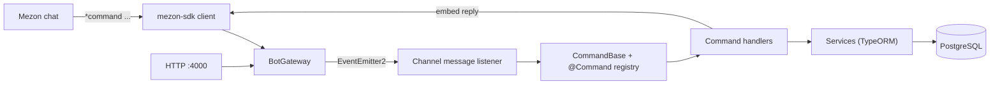

# DevHelp Bot for Mezon

A chat bot for the [Mezon](https://mezon.ai) platform that gives a development team a shared memory inside chat: save frequently used shell commands, log bugs with severity and status, attach solutions to bugs, and search all of it with one command.

Team project built on top of a Mezon bot template (see [Team](#team)).

  

## Overview

Developers repeatedly look up the same commands and re-debug the same problems. DevHelp keeps that knowledge in the team chat: a message such as `*command save ...` or `*bug create ...` is stored in PostgreSQL, and `*search <keyword>` finds matching commands, bugs and solutions. The bot connects to Mezon through `mezon-sdk`, routes prefixed messages to command handlers registered with a decorator, and replies with formatted embeds. Bot replies are written in Vietnamese.

## Key features

- **Command snippets** – save, list by category, view, find, update, soft delete and restore saved commands, with optional JSON `parameters` and `examples` (`src/bot/commands/command/command.command.ts`, `src/bot/services/command.service.ts`).
- **Bug log** – create bugs with severity (`low`, `medium`, `high`, `critical`), reproduction steps and an environment JSON; list by status (`open`, `in_progress`, `closed`); update fields (`src/bot/commands/bug/bug.command.ts`).
- **Solutions linked to bugs** – each solution belongs to a bug and can hold a code snippet; bug details show their solutions (`src/bot/commands/solution/solution.command.ts`, `src/bot/models/solution.entity.ts`).
- **Search** – case-insensitive substring search (`ILIKE`) across command title/command/description, bug title/description and solution title/description/code, either all at once or scoped to one type (`src/bot/services/search.service.ts`).
- **Bot on/off switch** – an in-memory active/inactive state; while inactive the bot ignores everything except the activate, deactivate and status commands (`src/bot/services/bot-state.service.ts`, `src/bot/events/bot.gateways.ts`).
- **HTTP status endpoints** – health check and bot status/control routes served by the same NestJS app (`src/health.controller.ts`, `src/app.controller.ts`).
- **Three command prefixes** – `*`, `/` and `\` are all accepted (`src/bot/utils/helps.ts`).

## Chat commands

Arguments use `--name=value`; wrap values containing spaces in double quotes. All commands also work with the `/` or `\` prefix.

| Command | Arguments | What it does |
| --- | --- | --- |
| `*help` | – | Overview of all commands |
| `*ping` | – | Health reply with the number of clans the bot is connected to |
| `*command save` | `--title`, `--command`, `--category` (required); `--desc`, `--parameters='{"k":"v"}'`, `--examples='["..."]'` | Save a command snippet |
| `*command list` | `--category` (required) | List non-deleted snippets in a category |
| `*command detail` | `--id` | Show one snippet |
| `*command find` | `--query` | Search snippets |
| `*command update` | `--id` plus any of `--title --command --desc --category --parameters --examples` | Update a snippet |
| `*command delete` | `--id` | Soft delete (sets `deleted = true`) |
| `*command restore` | `--id` | Undo a soft delete |
| `*bug create` | `--title` (required); `--desc`, `--severity`, `--steps`, `--environment='{"os":"..."}'` | Log a bug (status starts as `open`) |
| `*bug list` | `--status` (required) | List bugs with a given status |
| `*bug detail` | `--id` | Bug details with linked solutions |
| `*bug update` | `--id` plus any of `--title --desc --severity --status --steps --environment` | Update a bug |
| `*solution create` | `--bug-id`, `--title` (required); `--desc`, `--code` | Add a solution to a bug |
| `*solution list` | `--bug-id` | Solutions for a bug |
| `*solution detail` | `--id` | Show one solution |
| `*solution update` | `--id` plus any of `--title --desc --code` | Update a solution |
| `*search <keyword>` | – | Search commands, bugs and solutions |
| `*search commands\|bugs\|solutions <keyword>` | – | Search one type only |
| `*bot status` | – | Current state, since when, and inactive reason |
| `*bot on` / `*bot activate` | – | Activate the bot |
| `*bot off` / `*bot deactivate` | optional reason | Deactivate the bot |
| `*bot reset` | – | Disabled: replies that reset is turned off and the service should be restarted instead |
| `*activate`, `*active` | – | Activate the bot (accepted even while inactive) |
| `*deactivate` | optional reason | Deactivate the bot |
| `*botstatus` | – | Short status message |

Example:

```text
*command save --title="git-stash" --command="git stash apply" --desc="Apply latest stash" --category="git"
*bug create --title="JWT token not refreshed" --severity="high"
*solution create --bug-id=1 --title="Refresh before expiry" --code="await refreshToken()"
*search token
```

## Tech stack

| Layer | Technology |
| --- | --- |
| Runtime | Node.js 18 (`engines` in `package.json`) |
| Framework | NestJS 10 (`@nestjs/core` 10.4), `@nestjs/event-emitter`, `@nestjs/config` with Joi validation |
| Chat platform | `mezon-sdk` 2.7.99 |
| Persistence | PostgreSQL via TypeORM 0.3 (`pg` driver) |
| Language / tooling | TypeScript 5, ESLint, Prettier, Jest (scaffold only) |
| Package manager | Yarn 1 (`yarn.lock`) |

## Architecture

The NestJS application owns a single `MezonClient`. When a message arrives, `BotGateway` drops messages from the bot itself, checks the prefix and the on/off state, and re-emits the event through `EventEmitter2`. The channel-message listener passes the text to `CommandBase`, which looks up the handler class registered with the `@Command('<name>')` decorator and runs it. Handlers parse `--key=value` arguments, call a TypeORM service and reply to the channel.



### Data model

| Entity | Fields |
| --- | --- |
| `Command` | `id`, `title`, `command`, `description`, `category`, `parameters` (jsonb), `examples` (jsonb), `deleted`, timestamps |
| `Bug` | `id`, `title`, `description`, `status` (enum), `severity` (enum), `steps`, `environment` (jsonb), timestamps; one-to-many `solutions` |
| `Solution` | `id`, `title`, `description`, `code`, `bug_id` → `Bug`, timestamps |

Tables are created automatically on startup because TypeORM runs with `synchronize: true` (`src/app.module.ts`).

### HTTP endpoints

| Method | Path | Auth | Description |
| --- | --- | --- | --- |
| GET | `/` | none | Returns `Hello World!` |
| GET | `/health` | none | Mezon connection status, bot state and clan count |
| GET | `/bot-status` | none | Bot state details and connection info |
| POST | `/activate-bot` | none | Set the bot to active |
| POST | `/deactivate-bot` | none | Set the bot to inactive; optional JSON body `{ "reason": "..." }` |
| GET | `/reset-bot` | none | Returns a message that reset is disabled |

## Project structure

```text
src/
├── main.ts                    # Bootstrap: HTTP server, then bot event registration
├── app.module.ts              # Config validation, TypeORM (PostgreSQL), Mezon and bot modules
├── app.controller.ts          # Bot status/control HTTP routes
├── health.controller.ts       # /health
├── mezon/                     # MezonClient wrapper and dynamic module
└── bot/
    ├── base/                  # @Command decorator, command registry, base command class
    ├── commands/              # One folder per chat command (command, bug, solution, search, bot, ...)
    ├── events/bot.gateways.ts # Message filtering, prefixes, on/off gate
    ├── listeners/             # Channel message and button-click listeners
    ├── models/                # TypeORM entities: Command, Bug, Solution
    ├── services/              # CRUD/search services and bot state
    └── utils/                 # Argument parser, reply and embed helpers
bug.csv, command.csv, solution.csv   # Sample rows matching the entities (not loaded automatically)
```

## Getting started

### Prerequisites

- Node.js 18
- Yarn 1
- A PostgreSQL database
- A Mezon bot token

### Install and run

```bash
git clone https://github.com/tinhne/Devhelp-mezon.git
cd Devhelp-mezon
yarn install
```

Create a `.env` file in the project root (values below are placeholders):

```dotenv
POSTGRES_HOST=localhost
POSTGRES_PORT=5432
POSTGRES_USER=your-db-user
POSTGRES_PASSWORD=your-db-password
POSTGRES_DB=devhelp
MEZON_TOKEN=your-mezon-bot-token
PORT=4000
```

```bash
yarn start:dev                 # development with watch mode
yarn build && yarn start:prod  # compiled build from dist/
```

Invite the bot to a Mezon clan and type `*help` in a channel.

## Environment variables

| Name | Required | Description |
| --- | --- | --- |
| `POSTGRES_HOST` | yes | PostgreSQL host |
| `POSTGRES_PORT` | yes | PostgreSQL port |
| `POSTGRES_USER` | yes | Database user |
| `POSTGRES_PASSWORD` | yes | Database password |
| `POSTGRES_DB` | yes | Database name |
| `MEZON_TOKEN` | yes | Bot token used by `mezon-sdk` to log in |
| `PORT` | no | HTTP port, defaults to `4000` |

## Known limitations

- The on/off state lives in memory and is shared by every clan; it is not persisted.
- Chat commands and HTTP control routes have no permission checks, so any member (or anyone who can reach the HTTP port) can deactivate the bot or edit records.
- Search is a substring match, not full-text search.
- Only saved commands support soft delete and restore; bugs and solutions cannot be deleted from chat.
- `*bot reset` is intentionally disabled.
- Schema changes rely on `synchronize: true`; there are no migrations.
- There are no unit tests; `test/app.e2e-spec.ts` is the default NestJS scaffold and needs a live database and token.
- A button-click listener for view/update/delete/restore actions exists, but most replies no longer attach buttons.
- Some dependencies and constants (`better-sqlite3`, `qrcode`, `cron`, `src/bot/constants/tables.ts`) are leftovers from the template and are unused.

## Team

DevHelp was built by two people in June 2025:

| Contributor | Areas (from commit history) |
| --- | --- |
| Huu Thien (git author `NguyenHuuThien098`) | Bot on/off lifecycle (`bot`, `active`, `deactivate`, `botstatus` commands and `BotStateService`), `/health` and status endpoints, `ping`, Mezon connection and clan-resolution fixes, argument parser and reply helpers, embed layout updates |
| Lê Văn Trung Tính ([@tinhne](https://github.com/tinhne)) | Conversion of the template into DevHelp: `Command`, `Bug` and `Solution` entities and services, the `command`, `bug`, `solution` and `search` commands, button-click handlers; repository setup |

The bot scaffolding (decorator-based command registry, Mezon client module, NestJS/TypeORM wiring) comes from the [`mezonai/utility-mezon-bot`](https://github.com/mezonai/utility-mezon-bot) template by michael.mai, thai.phamquoc, man2807 and van-datncc. This repository starts from a single import commit on 2025-06-20; the earlier history, including the template and the first DevHelp commits, is kept in [`tinhne/mezon-bot-helpdev`](https://github.com/tinhne/mezon-bot-helpdev).

## Author

Contributor: **Lê Văn Trung Tính** — Software Engineer | AI Product Builder

- Website: [trungtinh.site](https://trungtinh.site)
- GitHub: [@tinhne](https://github.com/tinhne)
